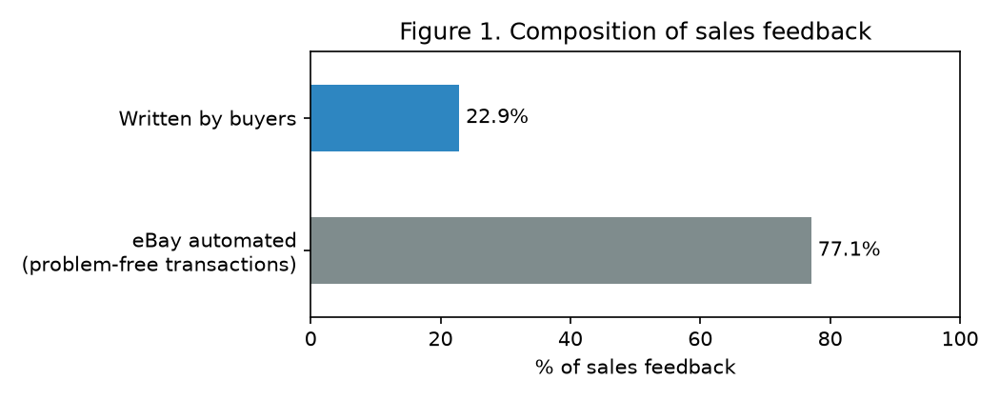
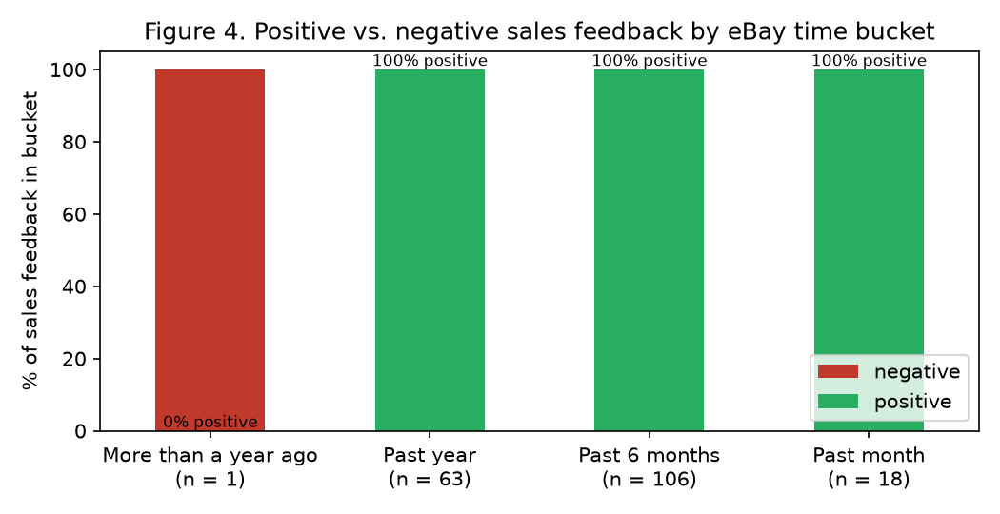
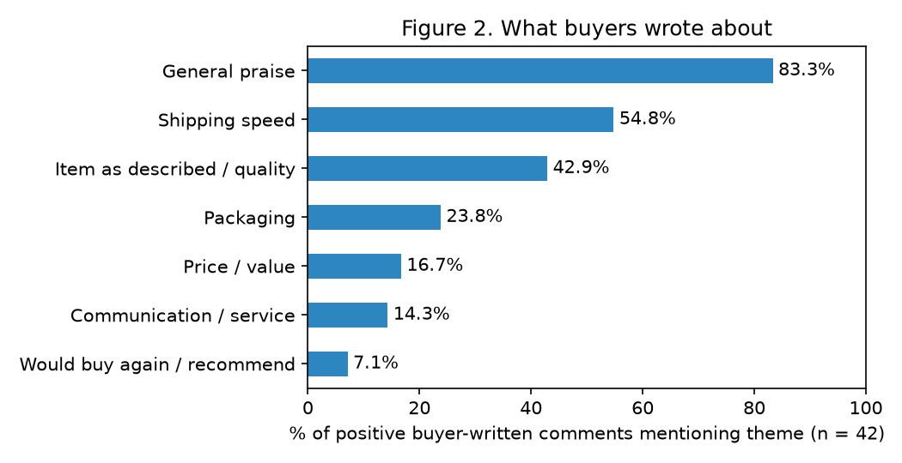

# What Builds Buyer Trust? A Consumer-Psychology Analysis of Customer Feedback at a Family-Run eBay Shop

**Author:** Henry Zhang

---

## Abstract

Online buyers must decide whether to trust sellers they never meet. This study examines the public feedback record of a small, family-run eBay resale shop (seller ID *zhashuzhan*; eBay Top Rated Seller; member since June 2015) to identify which aspects of the buying experience customers mention when they write feedback, and how consistent their satisfaction is over time. Buyer-written comments were coded with a transparent keyword codebook and scored with the VADER sentiment model. Of all captured sales feedback, 99.5% was positive, and 77.1% consisted of eBay-recorded, problem-free transactions. Among buyer-written comments, 97.7% were positive. Buyers most often mentioned shipping speed (54.8% of positive comments), the item matching its description (42.9%), and packaging (23.8%), and the mean sentiment of positive comments was strongly positive (VADER compound = 0.59). The shop's only negative entry, a non-delivery complaint, falls in eBay's "More than a year ago" period; eBay reports 100% positive feedback for the past 12 months. The findings suggest that, for this shop, buyer satisfaction is expressed mainly through reliability signals: fast shipping, accurate descriptions, careful packaging, and responsiveness when problems arise.

## Research Question

**When buyers of a small online shop leave feedback, which aspects of the transaction do they discuss, and how consistent is their satisfaction over time?**

The sellers' working view is that the shop maintains consistently strong reviews because it listens to its customers. This report treats that view as the sellers' practice and interpretation and asks what the public feedback record shows that is consistent with it; it does not test it as a proven cause.

## Background

Buying from a stranger online is fundamentally a problem of trust. Mayer, Davis, and Schoorman (1995) define trust as a willingness to be vulnerable to another party based on perceptions of that party's *ability*, *benevolence*, and *integrity*. In online marketplaces, buyers judge these qualities through signals such as reputation scores and the written experiences of previous buyers (Resnick & Zeckhauser, 2002).

Service-quality research provides a vocabulary for what buyers evaluate. The SERVQUAL model (Parasuraman, Zeithaml, & Berry, 1988) identifies five dimensions of service quality: *reliability* (delivering what was promised), *responsiveness* (willingness to help promptly), *assurance*, *empathy*, and *tangibles*. For an eBay seller, these map onto shipping speed and accurate descriptions (reliability), handling of problems and messages (responsiveness and empathy), and physical packaging (tangibles).

Feedback on eBay is known to be overwhelmingly positive (Resnick & Zeckhauser, 2002), so the *content* of written comments can be more informative than the share of positive ratings alone. This study therefore analyzes both: the overall consistency of the record and what buyers chose to write.

## Method

### Data Source

The shop's public eBay feedback page was captured, yielding 257 of the 259 listed entries (2 entries could not be captured). Each entry includes the comment text, the rating (positive, neutral, or negative), and eBay's time period (*Past month*, *Past 6 months*, *Past year*, or *More than a year ago*); entries for sales also include the item and price. eBay displays only these time periods, not exact dates, so all comparisons over time use them. Profile-level figures (positive-feedback percentage, Detailed Seller Ratings, and Top Rated status) were taken from the same public profile and are saved in `data/profile_summary.json`.

Entries were classified by source:

| Source | n | Role in analysis |
|---|---|---|
| Comments written by buyers of the shop | 43 | Theme coding and sentiment analysis (main sample) |
| eBay automated feedback | 145 | Consistency measure (problem-free transactions) |
| Feedback the account received *as a buyer* from other sellers | 69 | Excluded (not about this shop's service) |

*Note.* Buyer-written and automated entries together form the shop's **sales feedback** (n = 188). Of the 43 buyer-written comments, 42 were positive and 1 was negative.

**eBay automated feedback.** eBay generates positive feedback automatically on the buyer's behalf for transactions completed without any reported issue; every such entry in this dataset reads "Order delivered on time with no issues." These entries contain no buyer-written opinion, so they were not coded for themes or sentiment. Instead, they were treated as a measure of consistency: each one records an order that was completed smoothly, with no problem reported.

Buyer usernames were removed during processing and do not appear anywhere in this repository.

### Theme Coding

Each buyer-written comment was coded for seven themes using a keyword codebook (`analysis/codebook.json`): shipping speed, communication/service, item as described/quality, packaging, price/value, would buy again/recommend, and general praise. A comment received a theme if any of that theme's keywords appeared, and a single comment could receive several themes. Keyword coding is transparent and reproducible but less nuanced than human coding (see Limitations).

### Sentiment Scoring

Each buyer-written comment was scored with VADER (Hutto & Gilbert, 2014), a lexicon- and rule-based sentiment model designed for short, informal text. VADER's *compound* score ranges from −1 (most negative) to +1 (most positive).

### Reproducing the Analysis

```
pip install -r requirements.txt
python analysis/analyze.py
```

The script produces the cleaned sample (`data/buyer_comments.csv`), summary tables (`results/`), and all figures (`figures/`).

## Results

### Consistency of Satisfaction

eBay reports **100% positive feedback** for the shop over the past 12 months, with **no neutral or negative ratings** in the past 1, 6, or 12 months. All four Detailed Seller Ratings (accurate description, reasonable shipping cost, shipping speed, and communication) are displayed at the maximum of 5 stars, and the shop holds eBay's Top Rated Seller status.

In the captured sales feedback, **99.5% of entries were positive**. **77.1%** were eBay-recorded, problem-free transactions and 22.9% were comments written by buyers (Figure 1). The large share of automated entries indicates a high volume of orders completed without any reported issue, a direct measure of consistently smooth transactions.



*Figure 1.* Composition of the shop's sales feedback by source (n = 188). Feedback the account received as a buyer (n = 69) is excluded.

**Table 1.** Positive sales feedback by eBay time period

| eBay time period | % positive | n |
|---|---|---|
| More than a year ago | 0.0% | 1 |
| Past year | 100.0% | 63 |
| Past 6 months | 100.0% | 106 |
| Past month | 100.0% | 18 |

*Note.* Sales feedback includes buyer-written and eBay automated entries. The single entry in the earliest period is the shop's only negative feedback.



*Figure 4.* Percentage of positive and negative sales feedback in each eBay time period (n per period shown under each bar).

### What Buyers Wrote About

**Table 2.** Themes in positive buyer-written comments

| Theme | % of positive comments |
|---|---|
| General praise | 83.3% |
| Shipping speed | 54.8% |
| Item as described / quality | 42.9% |
| Packaging | 23.8% |
| Price / value | 16.7% |
| Communication / service | 14.3% |
| Would buy again / recommend | 7.1% |

*Note.* n = 42 positive buyer-written comments. A comment can mention more than one theme, so percentages sum to more than 100%.

Beyond general praise, **73.8%** of positive comments mentioned at least one concrete reliability or service theme (shipping speed, communication/service, accurate description, or packaging), and **50.0%** mentioned two or more specific themes (Figure 2).



*Figure 2.* Percentage of positive buyer-written comments mentioning each theme (n = 42).

### Sentiment

**Table 3.** Mean sentiment of buyer-written comments by eBay time period

| eBay time period | Mean VADER compound | n |
|---|---|---|
| More than a year ago | 0.273 | 1 |
| Past year | 0.593 | 24 |
| Past 6 months | 0.604 | 16 |
| Past month | 0.442 | 2 |

*Note.* VADER compound scores range from −1 (most negative) to +1 (most positive).

The mean compound score across all positive buyer-written comments was 0.590. Sentiment was stable across the two periods with substantial samples (Past year, 0.593; Past 6 months, 0.604). The means for "Past month" and "More than a year ago" are based on too few comments to interpret.

VADER scored the single negative comment as mildly *positive* (+0.273). Its text ("I never received the item on top of being charged…") states the problem factually and contains no strongly negative words, so the model missed a clearly negative experience. This illustrates that automated sentiment tools can misread complaints that are expressed without emotional language.


*Figure 3.* Mean VADER compound score of buyer-written comments in each eBay time period (n per period shown under each bar).

### Representative Comments

Comments are quoted verbatim, with original spelling and punctuation; the eBay time period is shown in brackets.

1. *"Seller did everything right. My purchase arrived very quickly in 3 days! It however, did not work/power-on and a Return was quickly accepted by the seller."* [Past 6 months]
2. *"An overall pleasant experience with the seller, good customer communication, thank you."* (excerpt) [Past 6 months]
3. *"Great seller, good communication, and a pleasure to deal with. A+"* [Past year]
4. *"Item as described, extremely well protected/ packaged. arrived in mint condition. Only complaint is user manual is in extremely small print ."* [Past month]
5. *"I never received the item on top of being charged for the item as well."* [More than a year ago; the shop's only negative entry]

## Discussion

**Consistency.** The clearest finding is consistency. Every sales-feedback entry in the three most recent eBay periods is positive, eBay reports 100% positive feedback over the past 12 months, and more than three-quarters of all sales feedback (77.1%) records a transaction completed with no reported issue. The sentiment of buyer-written comments is also stable across the periods with enough data to compare. For a small family-run shop selling a wide range of consumer goods, sustaining this record is the study's central result.

**Reliability is what buyers notice.** When buyers chose to write feedback, they most often described reliability: the item arrived quickly (54.8%), matched its description (42.9%), and was well packaged (23.8%). In SERVQUAL terms, reliability and tangibles dominate. This fits the trust framework of Mayer et al. (1995), in which delivering exactly what was promised is direct evidence of a seller's ability and integrity.

**Responsiveness when something goes wrong.** Communication and service were mentioned less often (14.3%), but these comments carry particular weight. The most telling comment (Quote 1) describes a product that did not work, yet the buyer still left positive feedback, crediting the seller's quick acceptance of a return. This reflects the service-recovery pattern, in which a seller's response to a problem can matter as much as the problem itself. Communication is also displayed at the maximum 5-star Detailed Seller Rating.

**The single complaint.** The shop's only negative entry is a non-delivery complaint recorded "More than a year ago." Every sales-feedback entry in the later periods is positive. Because eBay's time periods are coarse and there is only one negative entry, this report does not claim that the shop's record changed *because of* that complaint. The pattern is, however, consistent with the sellers' account of how they responded to it, described in the next section.

**Interpreting "we listen to our customers."** The sellers attribute their record to listening to customers. The feedback data supports the *outcome* side of this account (consistent satisfaction, maximum communication ratings, and buyers praising responsiveness), but as an observational record it cannot establish the cause.

## Seller Practices Informed by Customer Experience

*This section is based on the sellers' own account of their practices. It describes what the sellers report doing and was not independently verified from the feedback data.*

The shop's only negative feedback concerned an order that the buyer reported never receiving. The sellers report two practices aimed at ensuring that every order reaches its buyer reliably:

1. **Higher-quality shipping labels.** Henry and his father invested in a higher-quality printer to produce clearer shipping labels. This practice is intended to reduce delivery problems such as the non-delivery complaint described above.
2. **Continuous order and shipping monitoring.** Following the missed-delivery complaint, Henry's father began using a personal AI assistant (Grok Bot) to keep order and shipping notifications on track at all times, so that potential issues are identified and addressed promptly.

These practices reflect the sellers' approach of treating customer experience, including a single complaint, as information to act on. The subsequent feedback record is consistent with this approach: every sales-feedback entry captured in the three most recent eBay periods is positive, and eBay reports 100% positive feedback over the past 12 months. Because eBay provides only coarse time periods and this analysis is observational, however, it cannot establish that these practices caused the subsequent record.

## Limitations

- **Small sample of written comments.** Only 22.9% of sales feedback (n = 43) contains buyer-written text that could be coded and scored.
- **Nature of automated feedback.** eBay automated entries indicate that a transaction was completed without a reported issue; they do not capture a buyer's own evaluation. They were therefore used only as a measure of consistency, not as buyer opinion.
- **Coarse time information.** eBay provides only four time periods, not dates, so change over time cannot be measured precisely, and two periods contain only one or two written comments.
- **Positive skew.** eBay feedback is known to be overwhelmingly positive (Resnick & Zeckhauser, 2002), and dissatisfied buyers may choose not to leave feedback at all.
- **Incomplete capture.** 2 of the 259 listed feedback entries could not be captured, and captured counts are slightly lower than eBay's headline totals.
- **Keyword coding.** Themes were coded by keyword rather than by trained human raters, so some comments may be miscoded (for example, "fast" in "fast transaction," or a comment coded as communication that states communication "was not necessary"). No inter-rater reliability was computed.
- **Sentiment model limits.** VADER scored the one negative comment as positive, showing that it can miss complaints stated in neutral language.
- **Seller-reported practices.** The practices described in *Seller Practices Informed by Customer Experience* are based on the sellers' account and were not independently verified.
- **Correlational design.** This is an observational analysis; it cannot establish that any seller practice caused the ratings.

## Repository Structure

| Path | Contents |
|---|---|
| `data/raw_feedback_public.json` | Captured public feedback, with usernames removed |
| `data/profile_summary.json` | Public profile-level figures |
| `data/buyer_comments.csv` | Cleaned sample of buyer-written comments, with themes and sentiment scores |
| `analysis/codebook.json` | Keyword codebook for theme coding |
| `analysis/analyze.py` | Full analysis script |
| `results/` | Summary tables (CSV) |
| `figures/` | Figures 1–4 |

## References

Hutto, C. J., & Gilbert, E. (2014). VADER: A parsimonious rule-based model for sentiment analysis of social media text. *Proceedings of the International AAAI Conference on Web and Social Media, 8*(1), 216–225.

Mayer, R. C., Davis, J. H., & Schoorman, F. D. (1995). An integrative model of organizational trust. *Academy of Management Review, 20*(3), 709–734.

Parasuraman, A., Zeithaml, V. A., & Berry, L. L. (1988). SERVQUAL: A multiple-item scale for measuring consumer perceptions of service quality. *Journal of Retailing, 64*(1), 12–40.

Resnick, P., & Zeckhauser, R. (2002). Trust among strangers in Internet transactions: Empirical analysis of eBay's reputation system. In M. R. Baye (Ed.), *The economics of the Internet and e-commerce* (Advances in Applied Microeconomics, Vol. 11, pp. 127–157). Elsevier.
