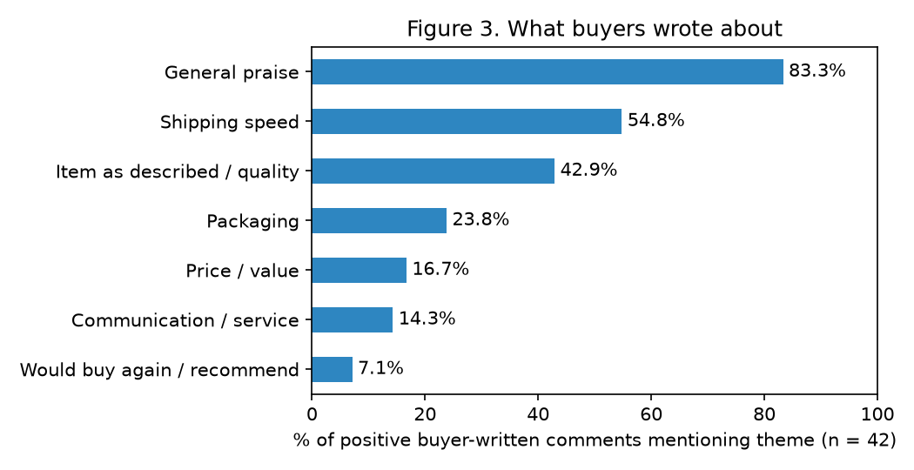
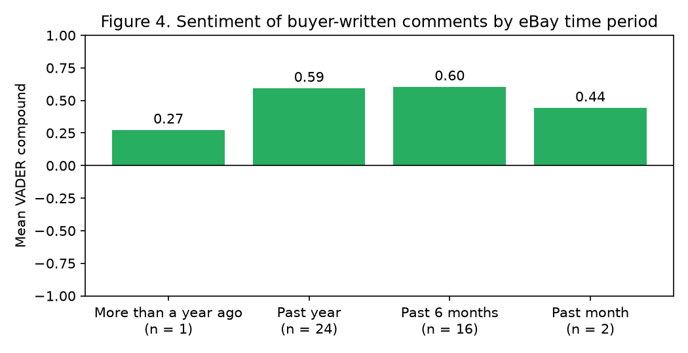

# eBay Customer Service Sample Project

### What Builds Buyer Trust? A Consumer-Psychology Analysis of Customer Feedback at a Family-Run eBay Shop

**Author:** Henry Zhang

---

## What this is

My dad and I run a small eBay resale shop (seller ID *zhashuzhan*). We've been on eBay since June 2015, and the shop is a Top Rated Seller. I went through our public feedback to see what buyers actually talk about when they review us, and whether their happiness holds steady over time. Short version: 99.5% of our sales feedback is positive, and buyers mostly care about fast shipping, getting what was described, and good packaging.

## What I wanted to find out

When buyers leave feedback for a small online shop, what do they talk about? And how steady is their satisfaction over time?

We've always felt our reviews stay strong because we listen to our customers. That's our own view, though. So I looked at what the feedback shows that lines up with it. I didn't try to prove it.

### Why trust matters

Buying from a stranger online takes trust. Psychologists describe trust as being willing to take a risk on someone because you believe they're capable, honest, and mean well (Mayer, Davis, & Schoorman, 1995). On eBay, buyers judge that mostly from a seller's ratings and what other buyers wrote (Resnick & Zeckhauser, 2002).

A well-known model of service quality, SERVQUAL, breaks good service into five parts (Parasuraman, Zeithaml, & Berry, 1988). Two matter most here: *reliability* (doing what you promised) and *responsiveness* (helping quickly when something's wrong). For an eBay shop, that means shipping fast, describing items honestly, packing well, and handling problems.

eBay feedback is almost always positive (Resnick & Zeckhauser, 2002). So I didn't just count ratings. I also read what people actually wrote.

## How I did it

I saved our public feedback page. It listed 259 entries, and I captured 257 of them (2 didn't load). eBay doesn't show exact dates, just four time periods: *Past month*, *Past 6 months*, *Past year*, and *More than a year ago*. So any "over time" comparison uses those.

The entries came from three places:

| Source | n | How I used it |
|---|---|---|
| Comments written by our buyers | 43 | Main sample: themes and sentiment |
| eBay automated feedback | 145 | Counted as problem-free orders |
| Feedback our account got as a *buyer* from other sellers | 69 | Left out (not about our shop) |

*Note.* Buyer comments plus automated feedback make up our **sales feedback** (n = 188). Of the 43 buyer comments, 42 were positive and 1 was negative.

**About the automated feedback.** When an order goes through with no reported problem, eBay leaves positive feedback for the buyer automatically. Every one of these says "Order delivered on time with no issues." There's no buyer opinion in them, so I didn't treat them as reviews. I counted them as what they are: orders that went smoothly.

I removed all buyer usernames. They don't appear anywhere in this project.

**Themes.** I sorted each buyer comment into topics using a simple keyword list (`analysis/codebook.json`). The topics were shipping speed, communication/service, item as described/quality, packaging, price/value, would buy again/recommend, and general praise. One comment can hit more than one topic.

**Sentiment.** I ran each comment through VADER (Hutto & Gilbert, 2014), a free tool that scores how positive the wording is. The sentiment score goes from -1 (very negative) to 1 (very positive).

To rerun everything:

```
pip install -r requirements.txt
python analysis/analyze.py
```

## What I found

### Buyers are happy, and it stays that way

eBay shows us at **100% positive** for the past 12 months, with no neutral or negative ratings in the past 1, 6, or 12 months. All four detailed seller ratings (accurate description, shipping cost, shipping speed, and communication) sit at the full 5 stars.

In the feedback I captured, **99.5% of sales feedback was positive**. And **77.1%** of it was eBay's automated "no issues" feedback, while 22.9% was written by buyers. That means most of our orders went through without a single reported problem.


*Figure 1.* Where our sales feedback comes from (n = 188). Feedback we got as a buyer (n = 69) isn't included.

**Table 1.** Share of positive sales feedback in each eBay time period

| eBay time period | % positive | n |
|---|---|---|
| More than a year ago | 0.0% | 1 |
| Past year | 100.0% | 63 |
| Past 6 months | 100.0% | 106 |
| Past month | 100.0% | 18 |

*Note.* Includes buyer comments and automated feedback. The one entry in the oldest period is our only negative review.


*Figure 2.* Positive vs. negative sales feedback in each eBay time period (n under each bar). Same data as Table 1.

### What buyers talk about

**Table 2.** Topics in positive buyer comments

| Topic | % of positive comments |
|---|---|
| General praise | 83.3% |
| Shipping speed | 54.8% |
| Item as described / quality | 42.9% |
| Packaging | 23.8% |
| Price / value | 16.7% |
| Communication / service | 14.3% |
| Would buy again / recommend | 7.1% |

*Note.* n = 42 positive buyer comments. Comments can mention more than one topic, so this adds up to more than 100%.

Besides general praise, **73.8%** of positive comments mentioned at least one specific thing we did well (shipping speed, communication/service, accurate description, or packaging). Half of them (**50.0%**) mentioned two or more.



*Figure 3.* How often each topic shows up in positive buyer comments (n = 42).

### How positive the wording is

**Table 3.** Average sentiment score of buyer comments by eBay time period

| eBay time period | Average sentiment score | n |
|---|---|---|
| More than a year ago | 0.273 | 1 |
| Past year | 0.593 | 24 |
| Past 6 months | 0.604 | 16 |
| Past month | 0.442 | 2 |

*Note.* Sentiment score = how positive the wording is, from -1 to 1.

Across all positive comments, the average score was 0.590. It barely moved between the two periods with enough comments to compare (0.593 for Past year, 0.604 for Past 6 months). The other two periods have only 1 or 2 comments, which is too few to say anything.

One surprise: VADER scored our one negative comment as slightly *positive* (0.273). The buyer said "I never received the item on top of being charged…" in a flat, factual way, with no angry words. So the tool missed it. Tools like this can miss complaints that don't sound emotional.



*Figure 4.* Average sentiment score of buyer comments in each eBay time period (n under each bar).

### In buyers' own words

These are copied exactly, typos and all. The time period is in brackets.

1. *"Seller did everything right. My purchase arrived very quickly in 3 days! It however, did not work/power-on and a Return was quickly accepted by the seller."* [Past 6 months]
2. *"An overall pleasant experience with the seller, good customer communication, thank you."* (excerpt) [Past 6 months]
3. *"Great seller, good communication, and a pleasure to deal with. A+"* [Past year]
4. *"Item as described, extremely well protected/ packaged. arrived in mint condition. Only complaint is user manual is in extremely small print ."* [Past month]
5. *"I never received the item on top of being charged for the item as well."* [More than a year ago; our only negative review]

### What it means

**We're consistent.** Every piece of sales feedback in the three most recent periods is positive. eBay has us at 100% positive for the past year. And 77.1% of our sales feedback is orders that went through with no problem at all. For a small family shop selling lots of different products, that steadiness is the main takeaway.

**Buyers notice reliability.** When people bothered to write something, they mostly said the item came fast (54.8%), matched the description (42.9%), and was packed well (23.8%). That's the "reliability" part of SERVQUAL. It also fits the trust research: doing exactly what you promised shows you're capable and honest (Mayer et al., 1995).

**How we handle problems counts.** Communication came up less often (14.3%), but those comments say a lot. In Quote 1, the item didn't even work, and the buyer still left positive feedback because we accepted the return quickly. Fixing a problem well can matter as much as the problem itself.

**The one complaint.** Our only negative review was about an order that never arrived, from "More than a year ago." Everything after it has been positive. With only one negative review and no exact dates, I can't say our record changed *because of* it. But it fits with what we did next, which is below.

## What we do differently

*This part is our own account of what we do. It isn't something the feedback data can check.*

Our only negative review came from a buyer who never got their order. After that, my dad and I focused on making sure every order gets where it's going:

1. **Clearer shipping labels.** We put money into a better printer so our shipping labels come out clearer. The goal is to cut down on delivery problems like the one that buyer had.
2. **Keeping an eye on every order.** After that missed delivery, my dad started using a personal AI assistant (Grok Bot) to keep our order and shipping notifications on track at all times. That way, if something starts to go wrong, we catch it fast.

To us, this is what listening to customers looks like: even one complaint is something to act on. Our feedback since then fits that. Everything in the three most recent eBay periods is positive, and eBay shows us at 100% positive for the past 12 months. Still, eBay only gives rough time periods and this is just looking back at existing data, so I can't prove these changes caused our record.

## What this doesn't prove

- **Only 43 written comments.** Just 22.9% of our sales feedback (n = 43) has words a buyer actually wrote.
- **Automated feedback isn't opinion.** It shows an order went through with no reported problem, not what the buyer thought. I only used it to show consistency.
- **No exact dates.** eBay only gives four time periods, so I can't track changes precisely. Two periods have just 1 or 2 written comments.
- **eBay feedback skews positive.** It's known to be mostly positive (Resnick & Zeckhauser, 2002), and unhappy buyers sometimes don't leave feedback at all.
- **2 entries missing.** I captured 257 of 259 entries, so my counts are a little lower than eBay's totals.
- **Keyword sorting isn't perfect.** I sorted comments by keywords, not by trained readers, so some got mislabeled. For example, "fast" in "fast transaction," or one comment counted as communication that actually says communication "was not necessary."
- **VADER can miss things.** It scored our one complaint as positive.
- **Our practices are self-reported.** "What we do differently" is our own account.
- **Can't prove cause.** This looks back at existing feedback. It shows what goes together, not what caused what.

## What's in this repo

| Path | What it is |
|---|---|
| `data/raw_feedback_public.json` | Our public feedback, usernames removed |
| `data/profile_summary.json` | Numbers from our public eBay profile |
| `data/buyer_comments.csv` | Buyer comments with topics and sentiment scores |
| `analysis/codebook.json` | Keyword list used to sort comments into topics |
| `analysis/analyze.py` | The full analysis script |
| `results/` | Summary tables (CSV) |
| `figures/` | Figures 1 to 4 |

## Sources

Hutto, C. J., & Gilbert, E. (2014). VADER: A parsimonious rule-based model for sentiment analysis of social media text. *Proceedings of the International AAAI Conference on Web and Social Media, 8*(1), 216–225.

Mayer, R. C., Davis, J. H., & Schoorman, F. D. (1995). An integrative model of organizational trust. *Academy of Management Review, 20*(3), 709–734.

Parasuraman, A., Zeithaml, V. A., & Berry, L. L. (1988). SERVQUAL: A multiple-item scale for measuring consumer perceptions of service quality. *Journal of Retailing, 64*(1), 12–40.

Resnick, P., & Zeckhauser, R. (2002). Trust among strangers in Internet transactions: Empirical analysis of eBay's reputation system. In M. R. Baye (Ed.), *The economics of the Internet and e-commerce* (Advances in Applied Microeconomics, Vol. 11, pp. 127–157). Elsevier.
